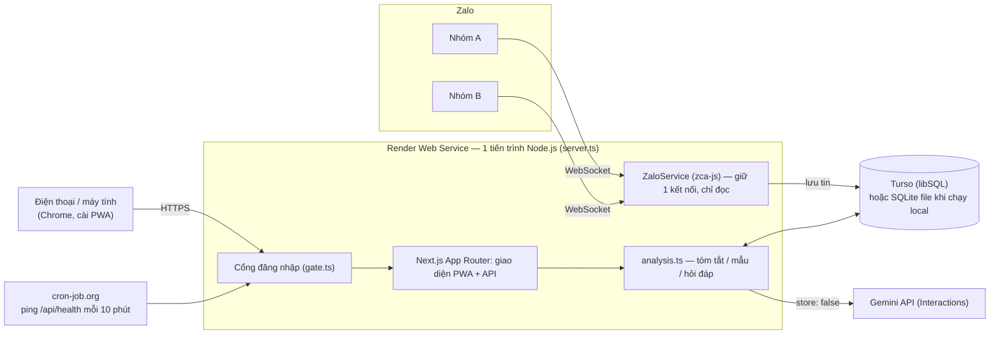
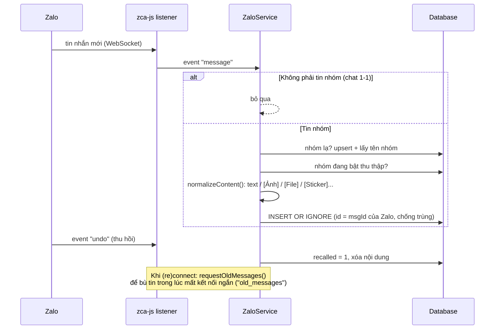
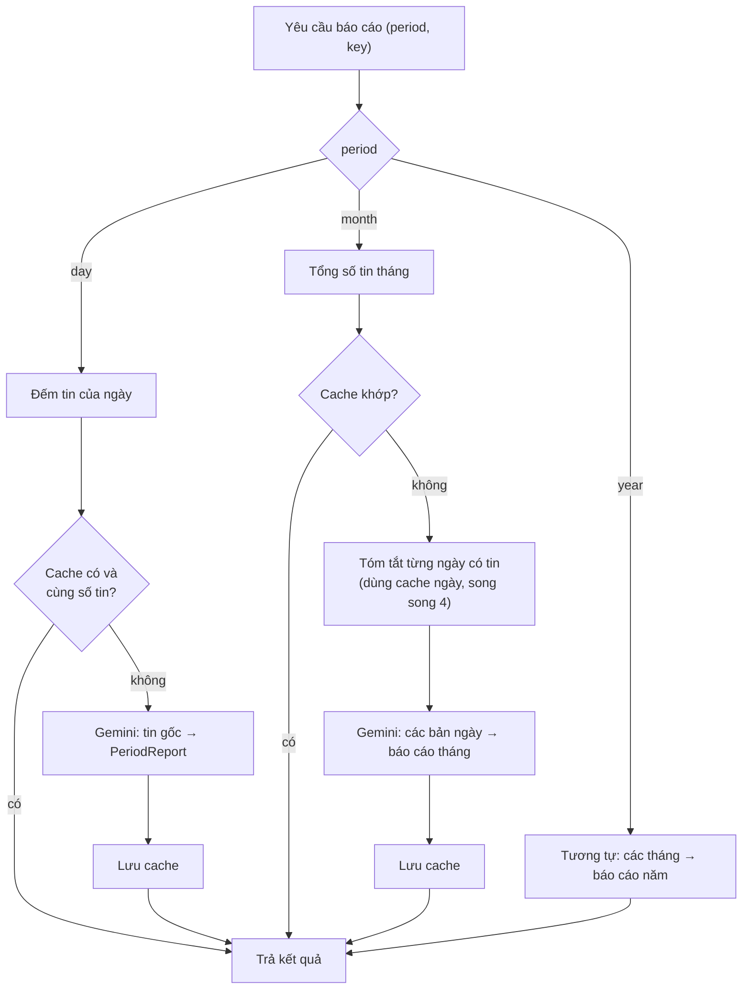
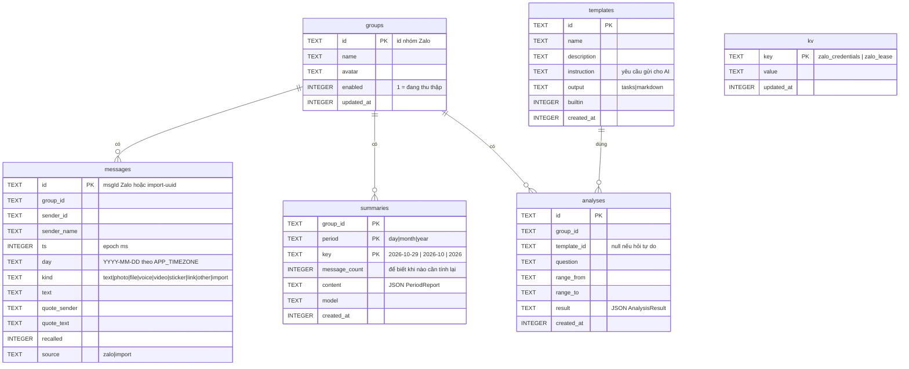
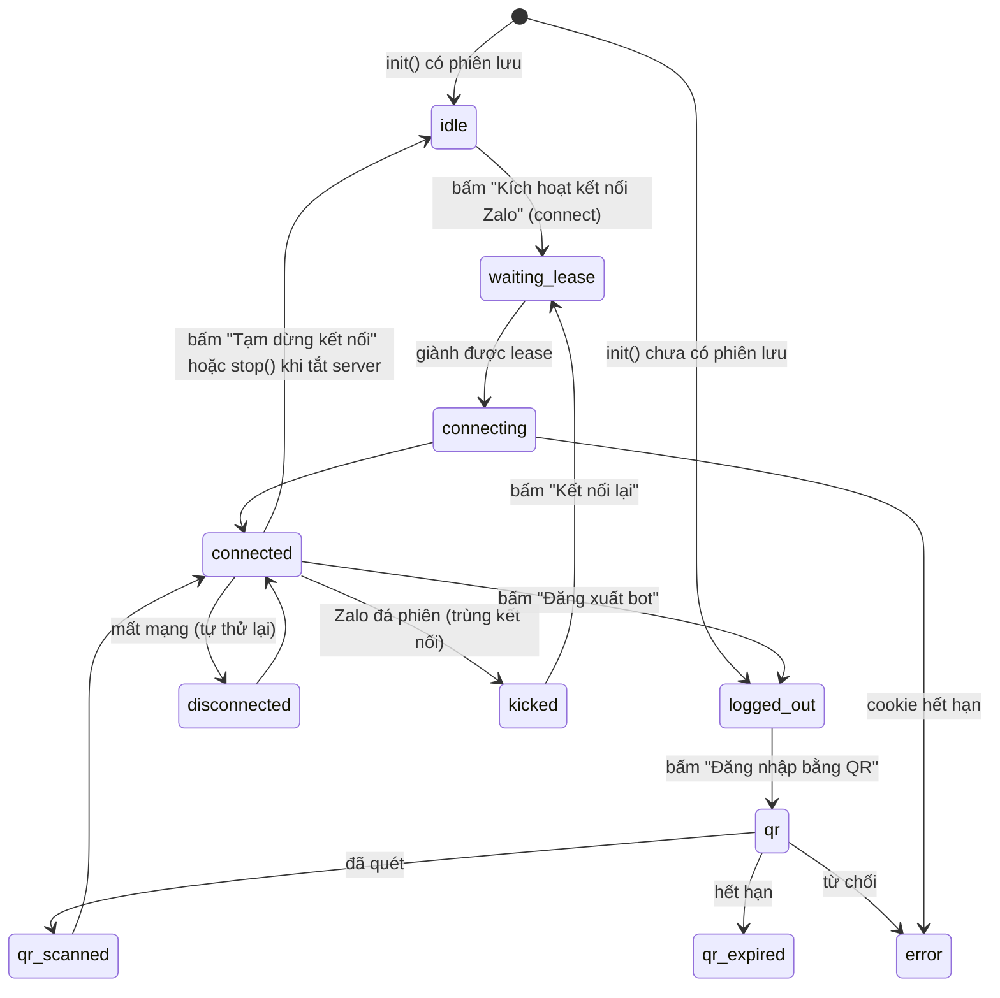

# Kiến trúc

Tài liệu này mô tả cách hệ thống hoạt động: thành phần, luồng dữ liệu, cơ sở dữ liệu và các cơ chế quan trọng.
Lý do của từng lựa chọn nằm trong [decisions.md](decisions.md).

## 1. Tổng quan



**Điểm cốt lõi:** listener Zalo và web app chạy **chung một tiến trình** liên tục. Đây là lý do app chạy trên Render (server chạy liên tục) chứ không chạy trên Vercel (serverless, không giữ được WebSocket).

## 2. Cấu trúc thư mục

```
server.ts                  Custom server: khởi động Next + ZaloService, cổng đăng nhập, tắt êm (SIGTERM)
src/
  lib/
    config.ts              Đọc biến môi trường (lazy, báo lỗi rõ ràng)
    db.ts                  Client libSQL dùng chung, schema, helper kv
    messages.ts            Lưu/đọc tin nhắn, nhóm; toTranscript() dựng bản ghi cho AI
    zalo/service.ts        ZaloService: đăng nhập QR/cookie, listener, lease, chuẩn hóa tin
    analysis.ts            Tóm tắt Ngày/Tháng/Năm (cache), chạy mẫu, hỏi tự do, schema JSON
    gemini.ts              Gọi Gemini (generateJson / generateText)
    templates.ts           Mẫu có sẵn + CRUD mẫu tự tạo
    auth.ts, crypto.ts     Token phiên (HMAC), mã hóa AES-256-GCM cho cookie Zalo
    gate.ts                Quyết định cho phép / 401 / chuyển hướng
    time.ts                Ngày theo múi giờ VN, định dạng thời gian có thứ
    http.ts                Bọc route handler, validate bằng zod
  app/                     Trang (/, /groups/[id], /templates, /login) và API (/api/*)
  components/              Hiển thị kết quả, markdown, helper fetch phía client
tests/                     Test harness (unit + integration, offline)
evals/                     Eval harness cho chất lượng AI
docs/                      Tài liệu
```

## 3. Luồng dữ liệu

### 3.1. Thu thập tin nhắn



### 3.2. Báo cáo Ngày → Tháng → Năm



- Khóa cache: `(group_id, period, key)`, kèm `message_count`. Có tin mới (hoặc tin bị thu hồi) thì số tin đổi và báo cáo được tính lại.
- Báo cáo tháng **không đọc lại tin gốc**, chỉ đọc các bản tóm tắt ngày. Nhờ vậy chi phí thấp và không vượt giới hạn ngữ cảnh, nhưng chi tiết nhỏ có thể bị mất.

### 3.3. Phân tích theo mẫu / hỏi tự do

1. `buildContext(from, to)` dựng bản ghi tin nhắn gốc của khoảng thời gian.
2. Nếu bản ghi dài hơn `MAX_TRANSCRIPT_CHARS` (mặc định 1,5 triệu ký tự), hệ thống chuyển sang dùng **tóm tắt ngày**. Kết quả khi đó có cờ `basedOn: "summaries"` và giao diện hiện cảnh báo.
3. Mẫu `output = "tasks"` gọi `generateJson` với `TASK_LIST_SCHEMA`; mẫu `output = "markdown"` gọi `generateText`.
4. Kết quả được lưu vào bảng `analyses` để xem lại lịch sử.

**Định dạng bản ghi gửi cho AI** (từ `toTranscript`):

```
[14:10 Th 5, 29/10/2026] Minh: @Hùng kiểm tra lỗi VNPay trước 5h chiều nay nhé
[14:12 Th 5, 29/10/2026] Hùng: Ok anh  (↪ trả lời Minh: "@Hùng kiểm tra lỗi VNPay...")
```

Mỗi dòng có **thứ trong tuần**, giúp AI quy đổi "mai", "thứ 6 này" theo thời điểm gửi tin. Sticker, tin rỗng và tin bị thu hồi bị loại khỏi bản ghi.

## 4. Cơ sở dữ liệu



- Chỉ mục: `messages(group_id, ts)`, `messages(group_id, day)`, `analyses(group_id, created_at)`.
- Schema được tạo bằng `CREATE TABLE IF NOT EXISTS` khi khởi động (`db.ts`). Hiện **chưa có hệ thống migration**. Khi đổi schema, phải viết câu lệnh `ALTER` tương thích ngược.
- `kv.zalo_credentials`: JSON `{imei, cookie, userAgent}` **đã mã hóa** AES-256-GCM, khóa sinh từ `SESSION_SECRET`.

## 5. ZaloService

### 5.1. Trạng thái



### 5.2. Lease nội bộ trong DB: chống hai nơi cùng bật kết nối

Nếu bạn vô tình bấm kích hoạt kết nối ở cả máy Local lẫn trên Render (cùng trỏ vào một DB Turso), hai kết nối Zalo dùng chung một phiên sẽ bị Zalo đá (`DuplicateConnection`).

- `kv.zalo_lease = {owner: instanceId, expires}`: đây hoàn toàn là **khóa nội bộ giữa Server của bạn và DB Turso**, **tuyệt đối không gửi request nào sang Zalo**.
- Vì hệ thống đã tách rời việc deploy khỏi việc tự động kết nối Zalo, chu kỳ gia hạn khóa được đặt rất thưa: **TTL 10 phút, gia hạn mỗi 3 phút** (tiết kiệm tối đa số lượt ghi vào DB).
- Giành lease bằng **một câu UPDATE có điều kiện** (nguyên tử): `WHERE owner = tôi OR expires < now`.
- Khi bấm **Tạm dừng kết nối** hoặc khi server tắt (`SIGTERM`), hàm `stop()` lưu lại cookie mới nhất rồi nhả lease ngay lập tức.

### 5.3. Phiên đăng nhập & Kích hoạt chủ động (Tách biệt rủi ro khi deploy)

- **Khi server khởi động (`init()`)**: hệ thống **không tự động gọi Zalo** mà chỉ kiểm tra xem trong DB đã có `zalo_credentials` hay chưa:
  - Chưa có phiên: `status = "logged_out"`, `hasSavedSession = false`.
  - Đã có phiên: `status = "idle"`, `hasSavedSession = true` (nằm chờ người dùng chủ động kích hoạt).
- **Lý do tách biệt**: khi phát triển hoặc cập nhật code liên tục trên Render, nếu mỗi lần container khởi động đều tự gọi `zalo.login()` từ IP datacenter, nick bot rất dễ bị hệ thống chống bot của Zalo quét và khóa. Việc tách rời deploy và kết nối giúp bạn deploy/kiểm tra giao diện, sửa prompt AI thoải mái mà không chạm tới Zalo.
- **Kích hoạt & Tạm dừng chủ động**:
  - Lần đầu: bấm **Đăng nhập bằng QR** (`loginQR`) → sự kiện `GotLoginInfo` → lưu `{imei, cookie, userAgent}` (mã hóa AES-256-GCM).
  - Các lần sau khi server khởi động lại: bấm **Kích hoạt kết nối Zalo** (`action: "connect"`) → dùng lại `credentials` đã lưu, **không cần quét QR**.
  - Khi cần tạm ngưng thu thập: bấm **Tạm dừng kết nối** (`action: "disconnect"`) → đóng WebSocket, lưu lại cookie mới nhất và nhả lease, giữ nguyên phiên đã lưu trong DB.
- Cookie được Zalo làm mới trong lúc chạy. Hệ thống lưu lại mỗi 6 giờ và khi tạm dừng / tắt server.

## 6. Bảo mật

| Lớp | Cơ chế |
| :--- | :--- |
| Truy cập web | Mật khẩu `APP_PASSWORD` → cookie `zai_session` (HMAC-SHA256, httpOnly, 30 ngày). Mọi đường dẫn trừ danh sách công khai **khớp chính xác** đều yêu cầu cookie (`gate.ts`). |
| Đường dẫn công khai | `/login`, `/api/auth/login`, `/api/health`, `/manifest.webmanifest`, `/icon.svg`, `/favicon.ico`, `/_next/*` |
| Phiên Zalo | Mã hóa AES-256-GCM trước khi lưu DB |
| Gemini | `store: false`: không lưu hội thoại phía Google. **Lưu ý:** gói Free của Gemini API vẫn có thể được dùng để cải thiện sản phẩm, nên dùng gói trả phí cho dữ liệu thật. |
| Đổi `SESSION_SECRET` | Làm mất hiệu lực mọi phiên web **và** phiên Zalo đã lưu (phải quét QR lại) |

## 7. Cấu hình

| Biến | Bắt buộc | Mặc định | Ý nghĩa |
| :--- | :-: | :--- | :--- |
| `APP_PASSWORD` | ✅ | | Mật khẩu web app |
| `SESSION_SECRET` | ✅ | | ≥ 32 ký tự; ký phiên + mã hóa cookie Zalo |
| `GEMINI_API_KEY` | ✅ khi phân tích | | Key Gemini |
| `GEMINI_MODEL` | | `gemini-3.8-flash` | Model dùng cho mọi phân tích |
| `TURSO_DATABASE_URL` | ✅ trên Render | `file:./data/zalo-ai.db` | URL libSQL |
| `TURSO_AUTH_TOKEN` | ✅ với Turso | | |
| `APP_TIMEZONE` | | `Asia/Ho_Chi_Minh` | Múi giờ chia ngày |
| `MAX_TRANSCRIPT_CHARS` | | `1500000` | Ngưỡng chuyển sang dùng tóm tắt ngày |
| `PORT` | | `3000` | |

## 8. API

Tất cả trả JSON. Mọi endpoint (trừ `health` và `auth/login`) yêu cầu cookie phiên.

| Method | Đường dẫn | Mô tả |
| :--- | :--- | :--- |
| GET | `/api/health` | Trạng thái (công khai, dùng cho cron ping) |
| POST | `/api/auth/login` · `/api/auth/logout` | Đăng nhập / đăng xuất web |
| GET / POST | `/api/zalo` | Trạng thái bot / `{action: connect \| disconnect \| qr \| reconnect \| logout \| sync_groups}` |
| GET | `/api/groups` | Danh sách nhóm + số tin |
| GET / PATCH | `/api/groups/:id` | Thông tin nhóm / `{enabled}` |
| GET | `/api/groups/:id/messages?day=` · `?prefix=` | Tin của 1 ngày / số tin theo ngày |
| POST | `/api/groups/:id/summary` | `{period, key, force?}` → báo cáo |
| GET / POST | `/api/groups/:id/analyses` | Lịch sử / `{from, to, templateId \| question}` |
| POST | `/api/groups/:id/import` | `{day, text}`: nhập tay đoạn chat |
| GET / POST | `/api/templates` | Danh sách / tạo mẫu |
| DELETE | `/api/templates/:id` | Xóa mẫu tự tạo |

