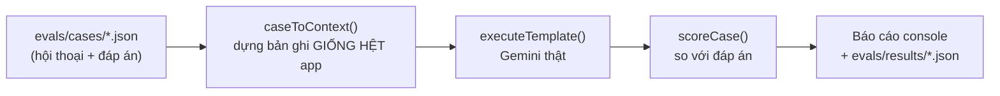

# Kiểm thử

Dự án có hai bộ kiểm thử (harness) với mục đích khác nhau:

| | Test harness | Eval harness |
| :--- | :--- | :--- |
| Kiểm tra | Code có **chạy đúng** không | AI có **trả lời đúng** không |
| Lệnh | `npm test` | `npm run eval` |
| Mạng | **Không** (Zalo, Gemini đều được giả lập) | Gọi Gemini thật |
| Chi phí / thời gian | 0đ · khoảng 3 giây | Vài nghìn đồng · khoảng 1 phút |
| Khi nào chạy | Mỗi lần sửa code; tự chạy trong bước build của Render | Khi đổi prompt, mẫu, model |
| Kết quả | Đạt / không đạt | Điểm số (F1, độ chính xác từng trường) |

## 1. Lệnh nhanh

```bash
npm test                 # toàn bộ test (offline)
npm run test:watch       # chạy lại khi sửa file
npm run check            # typecheck + test (nên chạy trước khi commit)
VERBOSE=1 npm test       # hiện cả log trạng thái [zalo]

npm run eval -- --dry-run                 # xem prompt sẽ gửi cho AI, không gọi API
npm run eval                              # chấm điểm AI trên toàn bộ ca mẫu
npm run eval -- --case reassignment       # một ca
npm run eval -- --repeat 3 --min-f1 0.8   # 3 lần/ca, thất bại nếu F1 < 0.8
GEMINI_MODEL=gemini-3.5-flash-lite npm run eval   # so sánh model khác
```

## 2. Test harness

### 2.1. Cấu trúc

```
tests/
  setup.ts                       Chặn mọi request mạng ra ngoài; ẩn log
  helpers/
    db.ts                        resetDb(), vn("2026-10-29 14:10"), msg(), seed*, waitFor()
    fake-zalo.ts                 Bản giả zca-js: FakeListener, createFakeApi, createFakeZalo, groupMessage
  unit/                          Hàm thuần, không DB
    time.test.ts                 Chia ngày theo giờ VN (kể cả sau nửa đêm), định dạng có thứ
    auth.test.ts                 Token phiên, mã hóa cookie, gate (chặn truy cập)
    normalize.test.ts            Chuẩn hóa tin Zalo, dựng bản ghi cho AI
    evals.test.ts                Logic chấm điểm của eval + kiểm tra bộ dữ liệu eval
  integration/                   Có DB (in-memory)
    messages.test.ts             Lưu tin, chống trùng, thu hồi, thống kê
    zalo-service.test.ts         Đăng nhập QR/cookie, thu thập, mất kết nối, lease
    analysis.test.ts             Cache tóm tắt, cuốn chiếu tháng/năm, mẫu, hỏi đáp (Gemini mock)
    api.test.ts                  Gọi trực tiếp route handler: validate, mã lỗi, luồng chính
```

### 2.2. Môi trường test

Được cấu hình trong `vitest.config.mts`:

- **DB**: `TURSO_DATABASE_URL=:memory:`. Mỗi file test chạy trong một tiến trình riêng (`pool: forks`). Gọi `resetDb()` trong `beforeEach` để xóa dữ liệu.
- **Mạng**: `tests/setup.ts` thay `fetch`. Nếu một test lỡ gọi Zalo hay Gemini thật, test đó **ném lỗi** ngay.
- **Biến môi trường** giả: `APP_PASSWORD=test-password`, `SESSION_SECRET` cố định, `GEMINI_API_KEY` giả.

### 2.3. Giả lập Zalo

`ZaloService` nhận `createClient` qua constructor, nên test có thể thay `zca-js` bằng bản giả:

```ts
const { api, listener } = createFakeApi([{ id: "g1", name: "Dự án ABC" }]);
const client = createFakeZalo(api);              // hoặc { qr: "expire" | "decline", loginFails: true }
const service = new ZaloService({ createClient: () => client, leasePollMs: 20 });

await service.startQrLogin();
await waitFor(() => service.state.status === "connected");

// Giả lập Zalo đẩy sự kiện, giống hệt thư viện thật:
listener.emit("message", groupMessage("g1", { msgId: "1", text: "Gửi báo cáo", dName: "Minh" }));
listener.emit("undo", { isGroup: true, data: { content: { globalMsgId: 1 } } });
listener.emit("closed", CloseReason.DuplicateConnection, "");
```

Nhớ gọi `service.stop()` trong `afterEach`, nếu không timer của lease sẽ còn chạy.

### 2.4. Giả lập Gemini

```ts
vi.mock("@/lib/gemini", () => ({ generateJson: vi.fn(), generateText: vi.fn() }));
const gemini = await import("@/lib/gemini");          // import SAU vi.mock
vi.mocked(gemini.generateJson).mockResolvedValueOnce({ summary: "...", tasks: [] } as never);
```

Kiểm tra **input gửi cho AI** qua `generateJson.mock.calls[i][1]` để đảm bảo prompt chứa đúng dữ liệu.

### 2.5. Khi viết test mới

- Thời gian luôn dùng `vn("YYYY-MM-DD HH:mm")`, không dùng `Date.now()`, để test không phụ thuộc vào ngày chạy.
- Handler của listener chạy bất đồng bộ, nên dùng `waitFor(...)` thay vì `setTimeout` cố định.
- **Sửa bug thì viết test tái hiện bug đó trước.** Ví dụ: test "so khớp chính xác" trong `auth.test.ts` được viết khi phát hiện gate cũ so khớp theo tiền tố (khi đó `/api/health-xyz` sẽ được coi là công khai).
- Test được kiểm chứng bằng cách **cố ý làm hỏng code** (mutation): bỏ bộ lọc tin 1-1 hoặc bộ lọc tin thu hồi thì test tương ứng phải báo lỗi. Hãy làm tương tự với logic quan trọng mới.

## 3. Eval harness (chất lượng AI)

### 3.1. Cách hoạt động



Eval dùng **chính** `systemPrompt`, `toTranscript`, `executeTemplate` và các mẫu có sẵn của app. Vì vậy điểm số phản ánh đúng những gì người dùng sẽ nhận được.

### 3.2. Định dạng một ca

```jsonc
{
  "id": "reassignment",
  "description": "Việc chuyển từ Hùng sang Tuấn: chỉ một đầu việc, người phụ trách cuối là Tuấn",
  "group": "Phòng Kinh doanh",
  "now": "2026-10-29 18:00",            // "thời điểm hiện tại" khi phân tích (giờ VN)
  "template": "tasks",                   // hoặc "unfinished"
  "messages": [
    { "at": "2026-10-29 09:00", "from": "Minh", "text": "@Hùng làm báo giá cho khách Phú Thái nhé" },
    { "at": "2026-10-29 09:26", "from": "Tuấn", "text": "Dạ em nhận",
      "reply": { "from": "Minh", "text": "..." } }   // tùy chọn; còn có "kind", "recalled"
  ],
  "expected": [
    {
      "keywords": ["bao gia"],           // mọi từ khóa phải có trong TIÊU ĐỀ việc (không dấu, theo ranh giới từ)
      "assignee": "Tuấn",                // tên phải nằm trong người phụ trách
      "status": "open",                  // todo | in_progress | done | open (= todo/in_progress) | any
      "deadline": "30/10/2026"           // chuỗi phải có trong hạn chót; "none" = không có hạn
    }
  ],
  "forbidden": [["sinh nhat"]]           // tiêu đề việc KHÔNG được chứa các bộ từ khóa này
}
```

### 3.3. Bộ ca hiện có

| Ca | Kiểm tra khả năng |
| :--- | :--- |
| `relative-deadlines` | Quy đổi "chiều nay", "mai" theo thời điểm gửi |
| `completion-update` | Nhận ra việc đã xong từ tin báo sau đó |
| `noise-only` | Không bịa việc từ chào hỏi, chúc mừng, rủ ăn trưa |
| `multi-tasks-one-message` | Tách một tin thành nhiều việc cho nhiều người |
| `reassignment` | Việc chuyển người: một đầu việc, người cuối cùng |
| `image-and-reply` | Việc giao kèm ảnh, nhận việc qua tin trả lời, "thứ 2 tuần sau" |
| `unfinished-only` | Mẫu tồn đọng: bỏ việc đã xong |
| `vague-acceptance` | "Để em xem" là nhận việc; nghỉ phép không phải việc |
| `after-midnight` | Tin lúc 00:15 nói "sáng nay" → hạn là ngày mới |
| `cancelled-task` | Việc bị hủy không phải việc tồn đọng |

### 3.4. Chỉ số

| Chỉ số | Ý nghĩa | Ngưỡng tham khảo |
| :--- | :--- | :--- |
| **Precision** | Trong số việc AI đưa ra, bao nhiêu % là đúng (thấp nghĩa là AI bịa thêm việc) | ≥ 85% |
| **Recall** | Trong số việc thật, AI tìm được bao nhiêu % (thấp nghĩa là sót việc) | ≥ 85% |
| **F1** | Trung bình điều hòa của hai chỉ số trên; dùng làm cổng chất lượng | ≥ 80% |
| Người phụ trách / Trạng thái / Hạn chót | Độ chính xác của từng trường, tính trên các việc đã khớp | ≥ 80% |
| Vi phạm danh sách cấm | Số lần AI tạo việc lẽ ra không được tạo | 0 |

LLM không cho kết quả giống nhau mỗi lần chạy. Khi so sánh hai phiên bản prompt hoặc model, hãy dùng `--repeat 3` trở lên.

### 3.5. Quy trình khi sửa prompt, mẫu hoặc model

1. `npm run eval -- --repeat 3` trên bản **hiện tại** để ghi lại điểm cơ sở.
2. Sửa `systemPrompt` / `BUILTIN_TEMPLATES` / schema trong `src/lib/analysis.ts` hoặc `src/lib/templates.ts`.
3. `npm run eval -- --dry-run --case <id>` để xem prompt mới trông thế nào.
4. `npm run eval -- --repeat 3` rồi so sánh. **Không merge nếu F1 giảm** hoặc xuất hiện vi phạm danh sách cấm.
5. Chạy `npm test`, vì các test trong `analysis.test.ts` kiểm tra cấu trúc prompt.

### 3.6. Thêm ca mới

Gặp một lỗi thực tế (AI sót việc, sai người, sai hạn)? Hãy biến nó thành một ca:

1. Tạo `evals/cases/<ten-ca>.json`: ẩn danh tên người, giữ đúng cách nhắn tin gây ra lỗi.
2. `npm test` để chạy kiểm tra offline (định dạng hợp lệ, từ khóa đáp án có trong tin nhắn, thời gian tin không vượt quá `now`).
3. `npm run eval -- --case <ten-ca>`: ca mới nên **thất bại** trước khi sửa prompt.

### 3.7. Test khi deploy

Không dùng GitHub Actions để build, vì Render đã tự build. Test được đưa thẳng vào lệnh build của Render (`render.yaml`):

```
npm ci && npm test && npm run build
```

- Test lỗi thì build lỗi, Render **giữ nguyên bản đang chạy**, bot Zalo không bị ngắt.
- `next build` đã bao gồm kiểm tra TypeScript.
- Eval **không** chạy khi deploy (tốn token, kết quả dao động). Chạy tay bằng `npm run eval` trên máy, hoặc workflow tùy chọn `.github/workflows/eval.yml` (Actions → AI Eval → Run, cần secret `GEMINI_API_KEY`).

